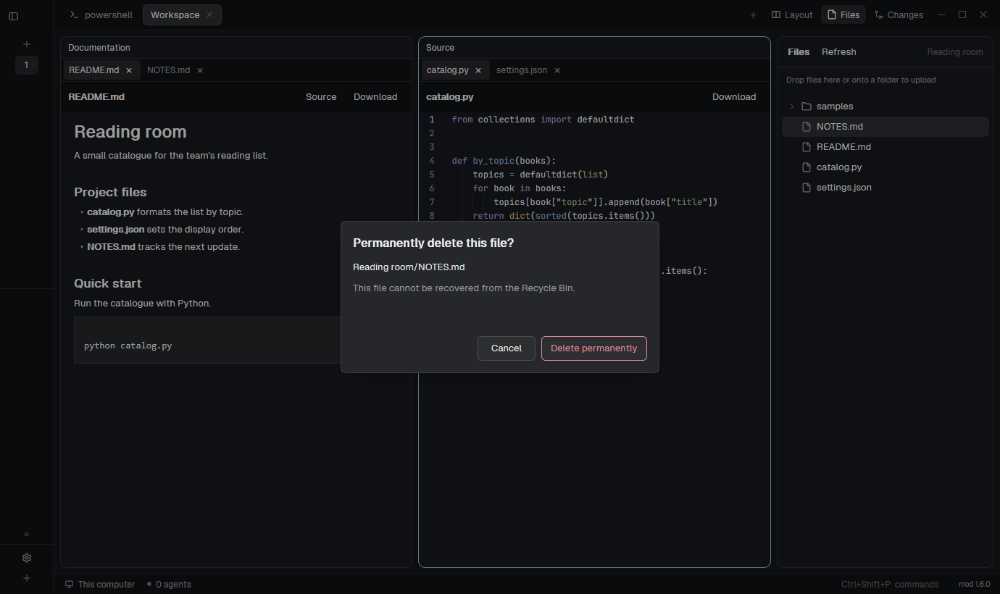
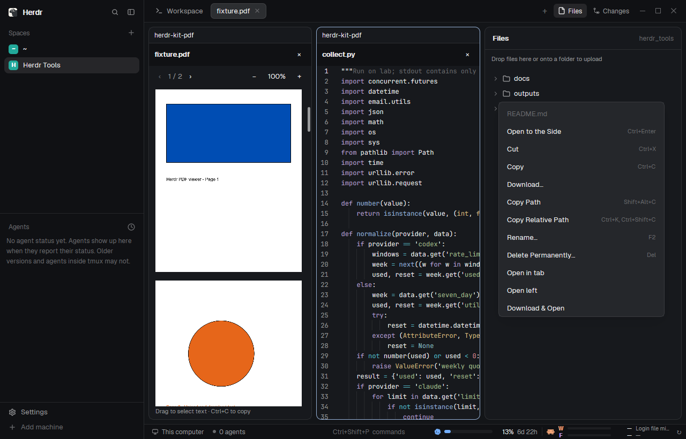
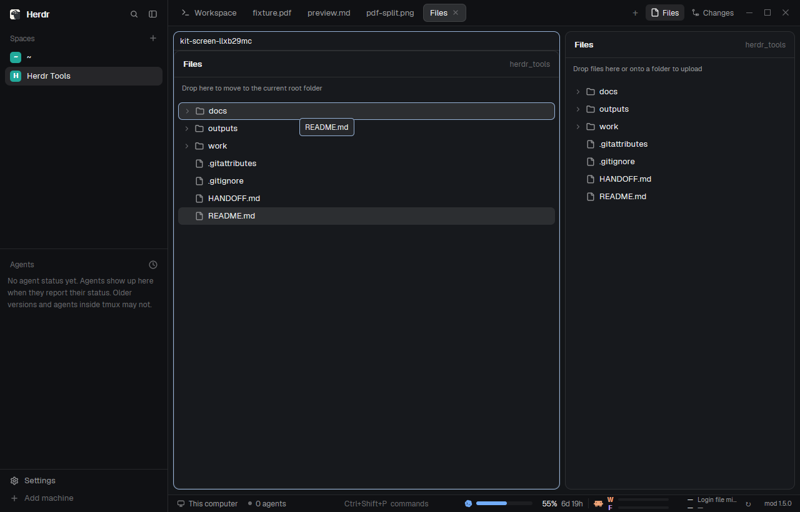
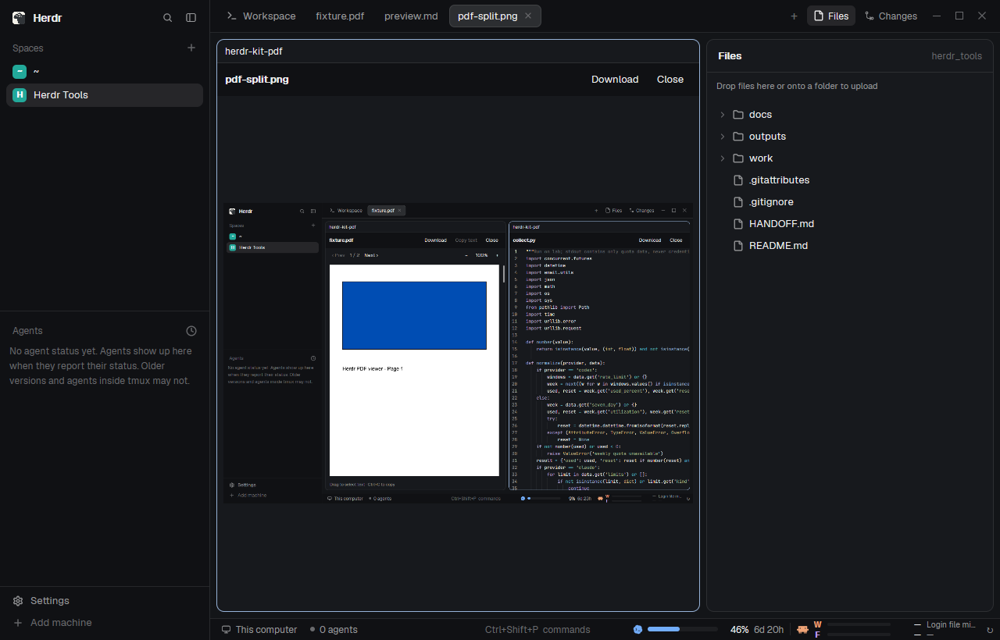
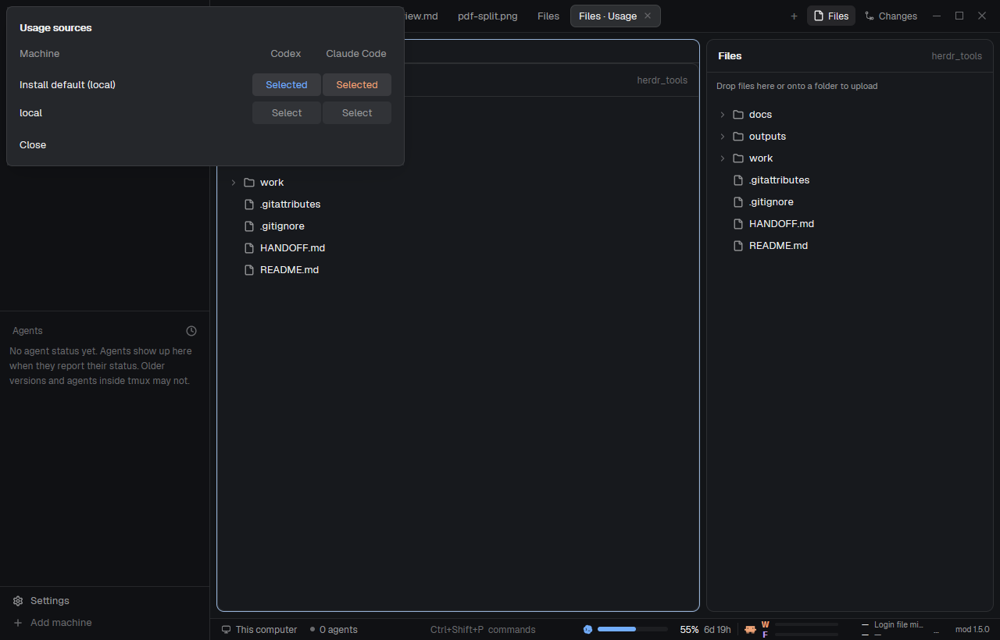

# Herdr Tools

Windows용 Herdr에서 파일을 옮기고 PDF와 코드를 나란히 읽으며 Codex 주간 사용량을 확인하는 모드 모음입니다. 아래 화면은 Windows용 Herdr 0.1.17에서 실행한 모드입니다.

## Windows 설치 및 업데이트

[Windows x64 설치 ZIP 다운로드](https://github.com/1ovoz/herdr_tools/raw/refs/heads/main/outputs/Herdr-Mod-Kit-Windows-x64-v1.6.0.zip) · [개발 인계 ZIP 다운로드](https://github.com/1ovoz/herdr_tools/raw/refs/heads/main/outputs/Herdr-Mod-Kit-Dev-v1.6.0.zip) · [SHA-256](outputs/SHA256SUMS)

Herdr 데스크톱 0.1.17과 Windows x64 Python 3.10 이상이 있는 PC에서 새 ZIP을 별도 폴더에 모두 풀고 `Herdr-Mod-Kit/Install-Windows.cmd`를 실행하세요. v1.4.0 또는 v1.5.0이 설치된 PC에서도 같은 순서로 업데이트할 수 있습니다. 설치 후 하단바 오른쪽에 `mod 1.6.0`이 표시됩니다. 업그레이드는 기존 기능 선택, 사용량 머신 및 키 설정을 보존합니다. 새 설치의 사용량 기본값은 `local`입니다. 설치 후 `Diagnose-Windows.cmd`로 확인할 수 있습니다.

직접 편집한 설치 파일과 새 파일이 충돌하면 설치기가 해당 경로를 표시하고 중단합니다. 수정본을 별도 위치에 보관하고 해당 경로를 비운 뒤 다시 실행하세요. 실행 중인 앱이 변경할 파일을 계속 잠그면 Herdr를 닫고 재실행하세요. SSH 머신 등록과 Windows의 기존 `main` 레이아웃은 이 설치기의 관리 대상 밖에 있습니다.

## 소스에서 설치

Windows x64에 Herdr 데스크톱과 Python 3.10 이상을 설치하고 Herdr를 한 번 실행한 뒤, 이 저장소 루트에서 다음 명령을 실행하세요. Herdr 공식 Windows 설치 프로그램이 herdr-core도 설치합니다. [Herdr 다운로드](https://herdr.dev/download/)

```powershell
py -3 -X utf8 work/kit-tools/stage.py
py -3 -X utf8 work/herdr-mod-kit/kit.py install --usage-machine local --activate
py -3 -X utf8 work/herdr-mod-kit/kit.py diagnose
```

`local`은 Windows 사용자의 Codex 로그인으로 사용량을 조회합니다. 개발·테스트 명령과 배포 절차는 [인계 문서](HANDOFF.md), 다른 PC에서 같은 체크아웃을 여는 방법은 [WSL 원격 작업 안내](docs/remote-work.md)에 있습니다.

## 분할 창과 파일 탭

상단 오른쪽 **Layout**에서 좌우 또는 상하로 분할하면 문서 창마다 별도의 파일 탭 줄이 생깁니다. Files에서 파일을 한 번 클릭해 선택하고, 더블클릭이나 `Enter`로 엽니다. 새 파일은 마지막으로 포커스한 문서 창에 추가됩니다. 같은 작업 공간에서 같은 머신의 같은 파일을 다시 열면 기존 탭으로 이동합니다. 터미널만 있는 창에서 처음 열 때는 실행 중인 터미널 옆에 문서 창이 생깁니다.

파일 탭의 **×**는 해당 파일 하나를 닫습니다. **Single pane view**로 한 창을 크게 보고 **Restore split view**로 분할 화면에 돌아갈 수 있습니다.


## Files 새로고침과 우클릭 메뉴

Files 헤더의 **Refresh** 또는 목록에서 `F5`를 누르면 현재 루트와 펼쳐 둔 폴더를 다시 읽습니다. 파일을 선택하고 `Del`을 누르면 경로가 표시된 삭제 확인창이 열립니다. 파일 행을 우클릭해 다음 작업을 실행할 수 있습니다. 단축키는 Files에서 대상을 선택했을 때 사용합니다.



| 작업 | 단축키 | 동작 |
| --- | --- | --- |
| 측면에서 열기 | `Ctrl+Enter` | 선택한 PDF나 텍스트를 오른쪽 분할에 엽니다. |
| 잘라내기 | `Ctrl+X` | 붙여넣을 때 파일을 이동합니다. |
| 복사 | `Ctrl+C` | 붙여넣을 때 파일 복사본을 만듭니다. |
| 다운로드… | — | Windows 저장 대화상자에서 이름과 위치를 고릅니다. |
| 경로 복사 | `Shift+Alt+C` | 선택한 파일이 있는 머신의 전체 경로를 복사합니다. |
| 상대 경로 복사 | `Ctrl+K` 다음 `Ctrl+Shift+C` | 현재 Files 루트 기준 경로를 복사합니다. |
| 이름 바꾸기… | `F2` | 새 이름을 입력합니다. 같은 이름이 있으면 기존 파일을 보존합니다. |
| 영구히 삭제 | `Del` | 대상 파일 경로를 확인하고 삭제 버튼을 눌러야 실행됩니다. |

복사하거나 잘라낸 파일은 같은 머신의 폴더 행, 루트 드롭 영역 또는 트리 빈 곳에 붙여넣습니다. 붙여넣기 단축키는 `Ctrl+V`입니다. 이동은 같은 파일시스템에서 지원하며, 목적지에 같은 이름이 있으면 두 파일을 그대로 둡니다. 탐색기에서 파일을 끌어와 업로드하거나 Files 안에서 폴더로 드래그해 이동할 수도 있습니다. 파일을 끌면 포인터 옆에 파일명이 표시됩니다. 강조된 폴더 행이나 상단 루트 영역에서 마우스를 놓으면 그 위치로 이동합니다.



검증용 탭에서 `README.md`를 `docs` 위로 끄는 상태를 재현한 화면입니다. 포인터 옆에는 파일명이, 받을 폴더에는 테두리가 표시됩니다.



## PDF·텍스트 분할과 탭

PDF 위에서 `Ctrl`을 누르고 휠을 위로 돌리면 확대되고, 아래로 돌리면 축소됩니다. 마우스 위치를 기준으로 50%부터 200%까지 25%p씩 조절합니다. 일반 휠로는 페이지를 연속 스크롤하며, 텍스트 레이어가 있는 문서에서는 글자를 선택해 복사할 수 있습니다. PDF와 텍스트 파일은 변경되면 열린 뷰에 다시 표시됩니다. 아래 화면은 동봉된 두 쪽짜리 PDF와 Python 소스를 한 탭에 나란히 연 모습입니다. 분할 창 제목을 탭 줄로 끌면 독립 탭이 되고, `Ctrl+W`로 활성 탭을 닫습니다.


## Markdown과 사진

Files에서 `.md`, `.markdown`, `.mdown`을 더블클릭하면 제목·목록·표·코드 블록이 있는 읽기 화면이 열립니다. **Source**와 **Preview**로 원문과 미리보기를 전환할 수 있습니다. 외부 이미지와 HTML은 자동으로 불러오지 않습니다.


PNG·JPG·JPEG 파일도 더블클릭하면 문서 탭에서 창 크기에 맞춰 열립니다. **Ctrl+Enter**로 옆에 열 수 있습니다. PNG 투명도와 JPEG의 EXIF 회전을 지원합니다. 미리보기는 원본을 보존하고 긴 변을 최대 2560픽셀로 표시합니다. 파일당 128 MiB, 1억 픽셀까지 지원합니다.



## 속도와 리소스 검증

Windows x64 Herdr 0.1.17에서 v1.0과 v1.4.0에 같은 파일을 사용했습니다. 전송은 4 MiB 임의 데이터 3회 중앙값, PDF는 같은 1800×2250 페이지를 캐시 없이 렌더링한 8회 중앙값입니다.

| 작업 | v1.0 | v1.4.0 |
| --- | ---: | ---: |
| 로컬 업로드 / 다운로드 | 3.308초 / 3.033초 | 0.036초 / 0.030초 |
| 같은 PC의 Herdr Core 경유 업로드 / 다운로드 | 4.484초 / 4.140초 | 1.141초 / 0.966초 |
| 위 전송 한 쌍의 Core 호출 수 | 50회 | 11회 |
| PDF 한 페이지 렌더링 | 103ms | 43ms |

외부 SSH 회선 속도는 이 측정에서 제외했습니다. 2000×2500 PDF를 같은 Windows 프로세스에서 32회 렌더링한 별도 시험에서는 8회 간격의 네 측정 모두 전용 메모리 17.79 MiB와 핸들 168개였습니다.

## Codex·Claude 사용량

하단바의 사용량 막대 → **Sources**에서 **Codex**와 **Claude Code**의 조회 머신을 각각 선택합니다. 예를 들어 Codex 열에서 **local**, Claude Code 열에서 **lab**을 선택하면 파란 막대는 Windows 계정의 사용량, Claude와 Fable 막대는 `lab`의 사용량을 표시합니다. **Install default**를 선택하면 해당 서비스는 설치 당시의 공통 머신 설정을 따릅니다.

원격 목록에는 이 Herdr에 등록된 머신이 표시됩니다. `lab`이 없는 PC에서는 먼저 **Add machine**으로 기존 서버를 연결하세요. 조회 대상 머신에 Python과 해당 서비스의 CLI 로그인이 필요합니다. 로그인 정보는 해당 머신에서 읽고 사용량 결과만 돌려받습니다.

아래는 원격 머신을 등록하기 전의 설정 화면입니다. 두 서비스는 현재 이 PC의 설치 기본값인 `local`을 사용합니다.




