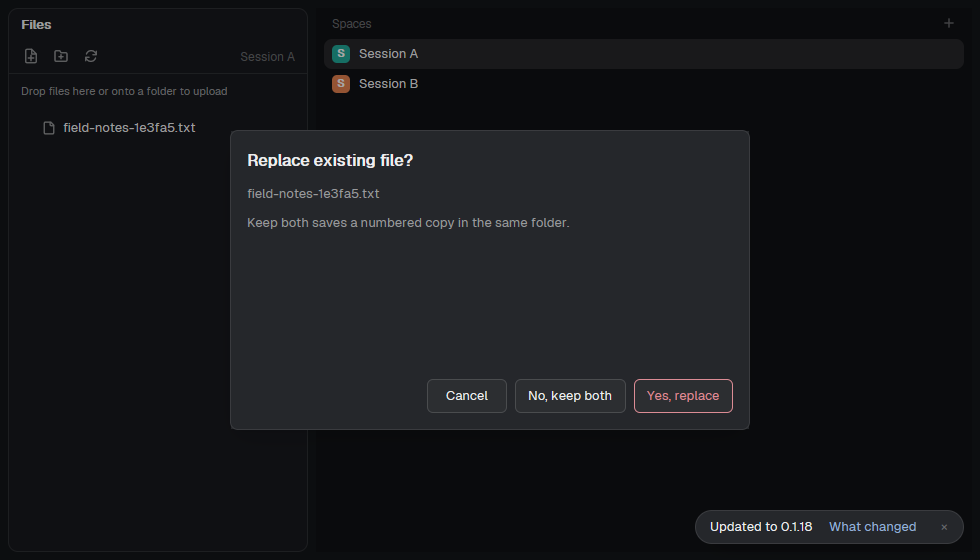
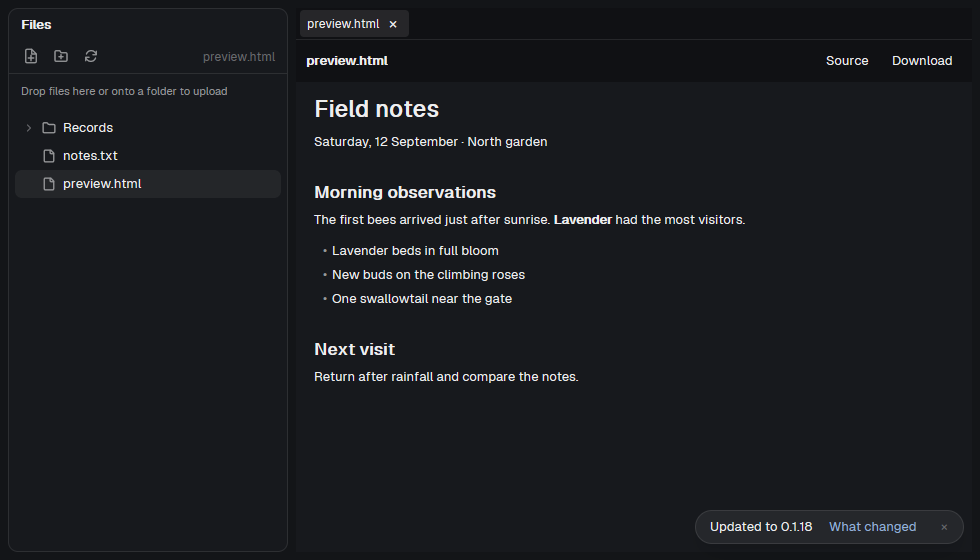
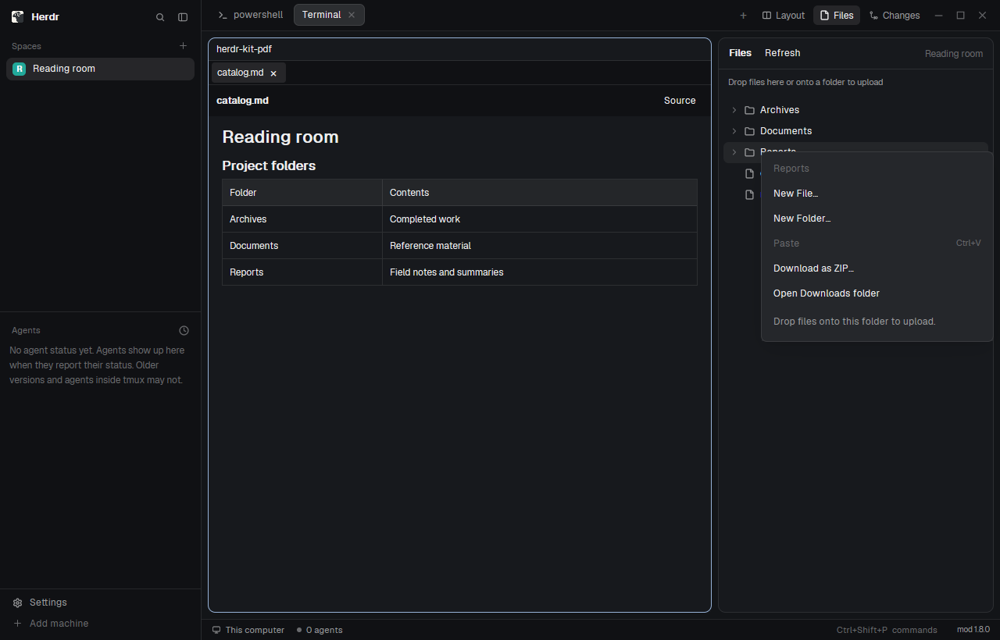
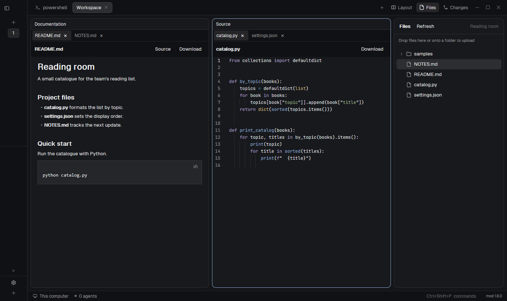
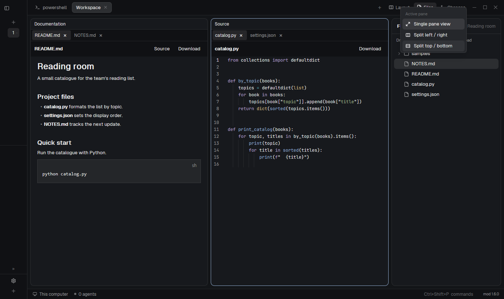
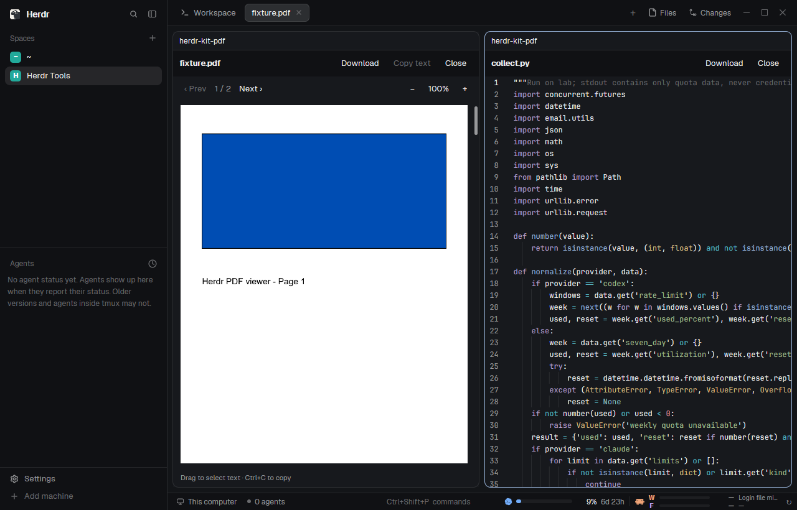
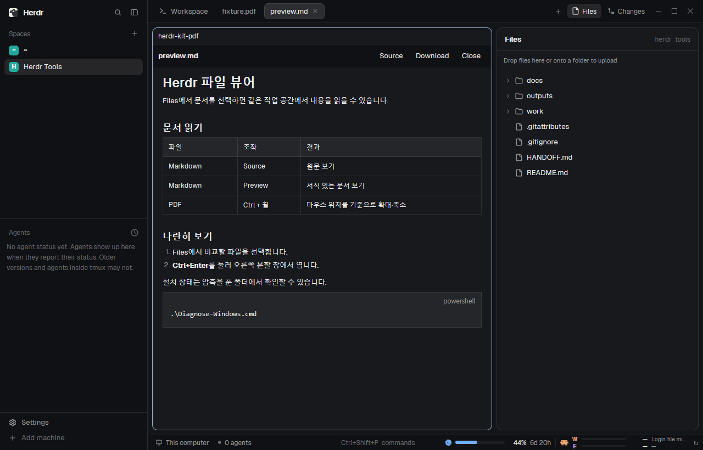
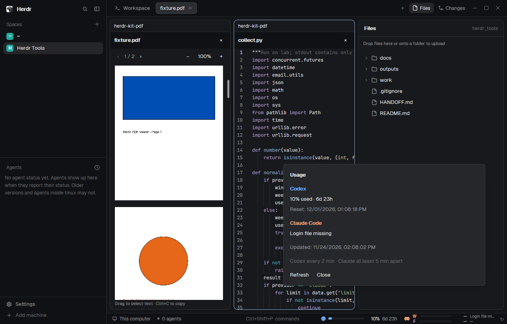

# Herdr Tools

Windows용 Herdr에 파일 관리, 문서 뷰어, 분할 탭, 사용량 표시를 추가합니다.

## **v1.9.1** 변경 사항

- 파일·폴더 ZIP을 다운로드할 때 같은 이름이 있으면 **Yes, replace**로 덮어쓰거나 **No, keep both**로 `보고서 (1).pdf`, `보고서 (2).pdf`처럼 저장합니다.
- 저장 위치 창이 열린 동안 Herdr의 **Cancel**을 누르면 해당 창과 다운로드 작업이 함께 닫힙니다. 실패 후 **Retry**를 누르면 다시 열린 저장 창에서 바로 취소할 수 있습니다.

[Windows x64 설치 ZIP 다운로드](https://github.com/1ovoz/herdr_tools/raw/refs/heads/main/outputs/Herdr-Mod-Kit-Windows-x64-v1.9.1.zip) · [개발 인계 ZIP 다운로드](https://github.com/1ovoz/herdr_tools/raw/refs/heads/main/outputs/Herdr-Mod-Kit-Dev-v1.9.1.zip) · [SHA-256](outputs/SHA256SUMS)

설치 ZIP의 압축을 풀고 `Herdr-Mod-Kit/Install-Windows.cmd`를 실행하세요. 기존 설치도 같은 방법으로 업데이트합니다.

## **v1.9.0** 변경 사항

Files 제목 아래에 새 파일, 새 폴더, 새로고침 아이콘이 생겼습니다. 왼쪽에서 작업을 고르고 오른쪽에서 선택한 항목 이름을 확인하세요. 파일을 선택한 상태에서 새 항목을 만들면 같은 폴더에 생성됩니다.

HTML 파일(`.html`, `.htm`)을 더블클릭하면 문서 탭에서 제목·목록·강조 등 기본 서식으로 읽을 수 있습니다. **Source**와 **Preview**로 원문과 미리보기를 전환합니다. 외부 리소스, CSS와 JavaScript는 실행하거나 불러오지 않습니다.

## Requirements

- Windows x64
- Herdr Desktop 0.1.17+
- herdr-core
- Python x64 3.10+

## 기능 소개

- **Files** — 파일·폴더 생성, 드래그 이동, 업로드·다운로드. 폴더 우클릭 → **Download as ZIP…**으로 폴더 전체를 저장합니다.
- **문서 뷰어** — PDF·HTML·Markdown·텍스트·PNG·JPEG를 탭에서 열고, PDF는 Ctrl+휠로 확대·축소합니다.
- **분할 탭** — 창마다 파일 탭을 따로 관리하고, 같은 파일을 다시 열면 기존 탭으로 이동합니다.
- **사용량** — 하단바에서 Codex·Claude 사용량을 확인하고, **Sources**에서 각각의 조회 머신을 선택합니다.

기능별 스크린샷

Files 단축키와 ZIP 다운로드 한도

| 작업 | 단축키 | 동작 |
| --- | --- | --- |
| 측면에서 열기 | `Ctrl+Enter` | 선택한 PDF나 텍스트를 오른쪽 분할에 엽니다. |
| 잘라내기 | `Ctrl+X` | 붙여넣을 때 파일을 이동합니다. |
| 복사 | `Ctrl+C` | 붙여넣을 때 파일 복사본을 만듭니다. |
| 다운로드… | — | Windows 저장 대화상자에서 이름과 위치를 고릅니다. |
| 경로 복사 | `Shift+Alt+C` | 선택한 파일이 있는 머신의 전체 경로를 복사합니다. |
| 상대 경로 복사 | `Ctrl+K` 다음 `Ctrl+Shift+C` | 현재 Files 루트 기준 경로를 복사합니다. |
| 이름 바꾸기… | `F2` | 새 이름을 입력합니다. 같은 이름이 있으면 기존 파일을 보존합니다. |
| 영구히 삭제 | `Del` | 대상 파일 경로를 확인하고 삭제 버튼을 눌러야 실행됩니다. |

폴더에 붙여넣기는 `Ctrl+V`, 새로고침은 `F5`입니다. ZIP은 빈 폴더를 포함하며 심볼릭 링크와 Windows 정션을 건너뜁니다. 한 ZIP에 최대 10만 항목, 경로명 합계 16 MiB까지 담을 수 있습니다.

속도와 리소스 측정값

Windows Herdr 0.1.18에서 설치 ZIP의 뷰어로 200쪽 PDF 전체를 넘긴 뒤 20쪽을 되돌아갔습니다. 100%와 125% 사이로 네 번 확대·축소하며 83초간 측정한 결과, 앱의 전용 메모리는 측정 시점 중 최고 457.4 MiB, 마지막 385.5 MiB였고 핸들은 최고 666개, 마지막 632개였습니다. 별도로 PDF 도우미에서 2000×2500 페이지를 32회 다시 렌더링했으며 8회 간격의 네 측정 모두 18.12 MiB와 핸들 168개였습니다.

v1.8.0은 글자가 많은 PDF에서 미리 읽은 쪽이 캐시 한도로 제거됐을 때 같은 위치에서 반복 렌더링하던 문제도 수정했습니다.

같은 Windows PC에서 4 MiB 파일을 세 번 전송한 중앙값을 비교했습니다.

| 전송 | v1.6.0 | v1.8.0 |
| --- | ---: | ---: |
| 로컬 업로드 / 다운로드 | 0.034초 / 0.028초 | 0.005초 / 0.010초 |
| Herdr Core 경유 업로드 / 다운로드 | 0.747초 / 0.625초 | 0.460초 / 0.330초 |
| Core 경유 전송 한 쌍의 호출 수 | 11회 | 5회 |

같은 조건에서 캐시를 비운 1800×2250 PDF 한 쪽의 렌더링 중앙값은 두 버전 모두 39ms였습니다.

이전 Windows x64 Herdr 0.1.17 시험에서는 v1.0과 v1.4.0에 같은 파일을 사용했습니다. 전송은 4 MiB 임의 데이터 3회 중앙값, PDF는 같은 1800×2250 페이지를 캐시 없이 렌더링한 8회 중앙값입니다.

| 작업 | v1.0 | v1.4.0 |
| --- | ---: | ---: |
| 로컬 업로드 / 다운로드 | 3.308초 / 3.033초 | 0.036초 / 0.030초 |
| 같은 PC의 Herdr Core 경유 업로드 / 다운로드 | 4.484초 / 4.140초 | 1.141초 / 0.966초 |
| 위 전송 한 쌍의 Core 호출 수 | 50회 | 11회 |
| PDF 한 페이지 렌더링 | 103ms | 43ms |

외부 SSH 회선 속도는 이 측정에서 제외했습니다. 2000×2500 PDF를 같은 Windows 프로세스에서 32회 렌더링한 별도 시험에서는 8회 간격의 네 측정 모두 전용 메모리 17.79 MiB와 핸들 168개였습니다.

[설치 및 진단 안내](work/herdr-mod-kit/README.md) · [소스 설치 및 개발 인계](HANDOFF.md) · [WSL 원격 작업](docs/remote-work.md) · [v1.7.0 변경 내역](docs/changes-v1.7.0.md)
